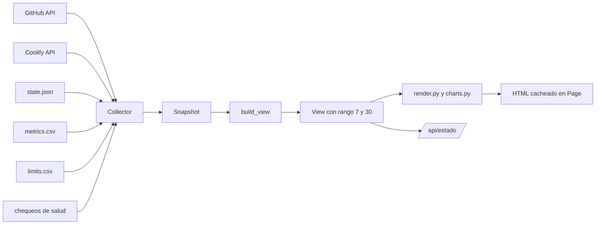

# Fase 5b: pantalla de estado nueva, con equipo, consumo y presupuesto

- **Fecha:** 2026-10-12
- **Autor:** Eduardo Jiménez (con Claude)
- **Estado:** diseño visual aprobado en Claude Design; spec pendiente de revisión escrita
- **Diseño:** canvas "Estado AI Dev Team", https://claude.ai/artifact/RrUtD84BVcAAbyqCEAuL4r (escritorio claro, escritorio oscuro y celular)
- **Spec hermano:** fase 5a (`2026-10-12-fase-5a-equipo-por-puestos-design.md`), que define los puestos, `metrics.csv`, `limits.csv` y las funciones de `team_report.py` que esta pantalla muestra.

## 1. Objetivo

Que `estado.maxiar.dev` responda en un vistazo, desde la compu o el celular:
1. qué espera de Eduardo;
2. qué está haciendo cada puesto y cuál se quedó sin cupo;
3. cómo va cada proyecto;
4. cuánto cuesta el equipo y qué conviene cambiar.

La página actual es una lista plana en una columna de 760 px. Con tres puestos, varios proyectos y métricas de consumo ya no alcanza.

### Criterios de éxito

1. La pantalla reproduce el diseño aprobado en Claude Design, en claro y oscuro (según el sistema) y a 390 px de ancho sin scroll horizontal de la página.
2. Cada puesto muestra su estado actual (trabajando, libre o sin cupo hasta una hora), su franja de las últimas 24 h y sus números del día.
3. La sección de consumo muestra los datos de `metrics.csv` y `limits.csv` en 7 y 30 días, con las alertas de decisión de la fase 5a.
4. Una fuente caída (GitHub, Coolify, el dispatcher o los CSV) solo deja sin datos su sección, como hoy.
5. La página sigue funcionando sin JavaScript. El JS solo mejora: evita recargar mientras hay una tabla abierta.

## 2. Arquitectura

Sin framework de frontend. Se mantiene el modelo actual: el servicio `estado` recolecta cada 60 s, arma una `View` con funciones puras y la sirve como HTML ya renderizado.

**Por qué no un framework:**
- la página es de solo lectura y se actualiza una vez por minuto;
- los gráficos son barras simples que se dibujan bien con HTML y CSS;
- un SPA sumaría build, dependencias y una API que proteger, sin ganar nada visible.

**Lo que cambia:**
- **Render separado de los datos.** `view.py` queda con `Snapshot`, `View` y `build_view`. El HTML pasa a `render.py` (nuevo), y los gráficos a `charts.py` (nuevo). Las tres son funciones puras.
- **Rango por URL.** `?rango=7` (por defecto) o `?rango=30`. El servidor arma los dos rangos en cada recolección y elige al responder. El selector son dos enlaces con aspecto de botón segmentado, con `aria-current`.
- **JSON para depurar.** `GET /api/estado` devuelve la `View` como JSON. Queda detrás de Access igual que la página. Sirve para probar y para una futura app, sin compromiso de formato estable.
- **Recarga.** Se reemplaza el `<meta refresh>` por un script de pocas líneas que recarga cada 60 s, salvo que haya un `
` abierto. Sin JS, se recarga con F5.
- **Tema.** Los tokens de color están en `:root` y se redefinen en `@media (prefers-color-scheme: dark)`. No hay botón de tema.
- **Tipografía.** Geist y Geist Mono desde Google Fonts, con `system-ui` y `ui-monospace` de respaldo.

## 3. Secciones

El orden es por urgencia y es el del diseño. Cada sección muestra su propio aviso de "sin datos" si falló su fuente.

### 3.1 Encabezado

- Título "Estado del equipo" y "Actualizado hace N s · se refresca cada 60 s".
- Píldoras de salud, una por chequeo de `run_checks` (Canvas, dispatcher, túnel, Coolify), con ícono y texto. Una falla muestra su detalle en el `title`.
- Botón "Pedir resumen": el mismo `POST /resumen` de hoy.

### 3.2 Te esperan

Una lista única, lo más viejo primero:
- **Decidir:** issues y PR con `needs:human`, con el último comentario del bot como motivo (hoy: `human_notes`).
- **Revisar y mergear:** PR que esperan a Eduardo, con el orden de merge, el estado de CI, conflictos, preview y las advertencias de archivos compartidos que ya calcula `build_view`.
- **Alertas de operación:** issues `ops` abiertos en `ai-dev-team`.

Cada fila lleva el tipo con ícono, `repo #n`, título, motivo, antigüedad ("hace 3 h") y el enlace "Abrir en GitHub". La antigüedad sale de `updated_at`, que `Item` suma como campo nuevo. Sin pendientes, la sección dice "Nada pendiente".

### 3.3 Equipo

Una tarjeta por puesto de `SLOTS`, en el orden configurado:
- **Nombre y plan:** `claude-senior` y una línea con el plan y el rol, de `SLOT_LABEL_<PUESTO>` (opcional; sin ella, el motor y el nivel).
- **Estado:**
  - *Trabajando:* hay una tarea activa con ese `slot` en `state.json`. El detalle dice rol, `repo #n` y hace cuánto.
  - *Sin cupo hasta HH:MM:* `slot_exhausted_until` del puesto está en el futuro.
  - *Libre:* en otro caso. El detalle cuenta la última tarea de `metrics.csv`.
- **Franja de 24 h:** 24 celdas, una por hora, desde hace 24 h hasta ahora:
  - trabajando (color del puesto), si alguna tarea del puesto se superpuso con esa hora; la tarea activa cuenta hasta ahora;
  - sin cupo (rayado), si no trabajó y algún corte de `limits.csv` o el agotamiento actual se superpuso;
  - libre, en otro caso.

  Cada celda tiene `title` con la hora y el estado. La franja tiene un `aria-label` con el resumen.
- **Números de 24 h:** tareas, horas trabajando y horas sin cupo.
- **Pie:** uso en 7 días y cortes en 7 días. En Gemini, además, imágenes y su costo.

Las horas se muestran en `ESTADO_TZ` (nuevo, por defecto `America/Argentina/Buenos_Aires`), la zona de Eduardo. Esto no cambia `LIMIT_TZ`, que es la zona en la que Codex escribe la hora.

### 3.4 Proyectos

Una tabla con una fila por repo de `REPOS`. Las columnas son las etapas: Por hacer, Dev, Review, QA, Fix y Te espera. Cada celda cuenta issues y PR abiertos en esa etapa.

Las etapas salen de `_stage`, agrupadas así:

| Columna | Etapas de `_stage` |
|---|---|
| Por hacer | `backlog`, `listo para agentes`, `bloqueado` |
| Dev | tarea activa de rol dev o docs |
| Review | `review (en cola)` o tarea activa de review |
| QA | `QA (en cola)` o tarea activa de QA |
| Fix | `fix (en cola)` o tarea activa de fix |
| Te espera | `necesita a Eduardo` y `espera a Eduardo` |

Debajo del nombre del repo va la épica en curso: el issue abierto con etiqueta `epic` y número más bajo que tenga sub-issues, con la barra de avance de `sub_issues_summary` (`completed` de `total`). Esos datos ya vienen en el listado de issues; no hacen falta llamadas nuevas.

Cada fila tiene un `
` "Ver issues" con la lista actual (número, título y etapa), para no perder el detalle que hoy muestra "Trabajo en curso". La tabla vive en una caja con `overflow-x: auto`.

### 3.5 Despliegues y credenciales

- **Apps de Coolify y previews de PR abiertos:** lo mismo de hoy, como filas con ícono de estado.
- **Credenciales:** todos los vencimientos configurados, no solo los próximos a vencer.
  - Más de 30 días: ok.
  - Entre 7 y 30 días: advertencia.
  - Menos de 7 días o vencido: crítico.

### 3.6 Consumo y presupuesto

Toda la sección usa el rango elegido (7 o 30 días).

- **Cuatro cifras:**
  1. *Costo estimado:* la suma de `slot_stats(...).cost_usd`, es decir el fijo prorrateado más las imágenes, con el desglose debajo.
  2. *Issues cerrados* en el rango, sin contar épicas, y el costo por issue.
  3. *Retrabajo:* rondas de fix y QA por issue (`_rework` sobre todas las filas del rango).
  4. *Cortes por límite:* la cantidad de filas de `limits.csv` en el rango y las horas sin cupo sumadas.
- **Horas de trabajo por día y puesto:** barras apiladas, una por día, con la leyenda de los tres puestos. Cada barra tiene un `title` con los valores. El botón "Ver como tabla" abre un `
` con la tabla día por puesto. La escala va en horas, con un tope redondeado hacia arriba a un número par.
- **Horas sin cupo por puesto:** barras horizontales con el valor y la cantidad de cortes.
- **Tiempos de flujo** (medianas de los issues cerrados por un PR mergeado en el rango):
  - *Issue a PR:* del `inicio` del primer dev del issue en `metrics.csv` al `fin` del dev que terminó con `pr_abierto`;
  - *PR a merge:* `created_at` a `merged_at` del PR. Incluye la review de Eduardo y así se aclara en la etiqueta;
  - *Total:* del primer dev al merge.
- **Para decidir:** las frases de `decision_alerts`, con ícono de advertencia. Sin alertas, "Nada para decidir".

Los datos de GitHub de esta sección (issues cerrados y PR mergeados, de `search_since`) se piden como mucho cada 10 minutos, para no gastar la cuota de búsqueda. Los CSV se leen en cada recolección.

### 3.7 Resumen

El resumen del operador de hoy (`render_summary`) con el estilo nuevo: texto, hora de generación, aviso si está generando y el botón.

## 4. Diseño visual

- **Fuente de verdad:** el canvas de Claude Design. Los datos del canvas son de ejemplo; los textos fijos y la estructura son los finales.
- **Colores de puesto, fijos por entidad y nunca por orden** (paleta validada con el script de dataviz, sin FAIL en claro ni en oscuro):

  | Motor | Claro | Oscuro |
  |---|---|---|
  | Gemini | `#2a78d6` | `#3987e5` |
  | Claude | `#eb6834` | `#d95926` |
  | Codex | `#1baf7a` | `#199e70` |

  El aqua en claro tiene menos de 3:1 de contraste: el nombre del puesto siempre va al lado. Un puesto nuevo hereda el color de su motor.
- **Superficies y tinta:** claro `#f3f2ee` de fondo, `#fcfcfb` en tarjetas y `#0b0b0b` de tinta. Oscuro `#121211`, `#1a1a19` y `#ffffff`. Tinta secundaria `#52514e` y `#c3c2b7`.
- **Estados, siempre con ícono y texto:** bien `#0ca30c`, advertencia `#fab219`, serio `#ec835a` (sin cupo, con rayado) y crítico `#d03b3b`. Íconos SVG en línea, sin emojis.
- **Marcas finas:** separación de 2 px entre segmentos y extremos redondeados de 4 px en la punta de cada barra.
- **Accesibilidad:**
  - botones y enlaces reales, de al menos 44 px de alto en celular;
  - `aria-label` en los gráficos y tablas equivalentes;
  - el texto cumple 4,5:1.

## 5. Cambios por componente

| Componente | Cambio |
|---|---|
| `models.py` | `Item.updated_at: str = ""`; `Item.sub_issues: tuple[int, int] \| None` (completados, total) |
| `github.py` | `list_open_items` llena `updated_at` y `sub_issues`; `search_since` suma `created_at` y, para PR, `merged_at` (`pull_request.merged_at`) |
| `team_report.py` | Nuevas funciones puras: `hour_strip`, `daily_hours`, `flow_times` |
| `view.py` | `Snapshot` suma `limits`, `slots`, `slot_costs`, `slot_labels`, `exhausted`, `closed`, `merged` y `tz`. `View` suma `slots`, `projects`, `credentials` y `budget` por rango. `build_view` las arma; `render` sale de este archivo |
| `render.py` (nuevo) | HTML completo, CSS con tokens, íconos |
| `charts.py` (nuevo) | Barras apiladas, barras horizontales y franja de 24 h, como HTML |
| `estado.py` | `Collector` lee `limits.csv`, `slot_exhausted_until` y la configuración de puestos, y cachea las búsquedas 10 min; `GET /?rango=`, `GET /api/estado` |
| `config.py` | Una función compartida para leer `SLOTS` y `SLOT_COST_*`, que usan el dispatcher y `estado` |
| `docker-compose.yml` | `estado` recibe `SLOTS`, `SLOT_COST_*`, `SLOT_LABEL_*`, `GEMINI_IMAGE_USD`, `LIMITS_PATH`, `ESTADO_TZ` |
| `scripts/estado-demo.py` (nuevo) | Renderiza la página con un `Snapshot` de ejemplo a un HTML local, para revisarla contra el diseño sin la mini-PC |
| `README.md` | La sección de la vista de estado, con las variables nuevas |

## 6. Pruebas

- **Tests unitarios:**
  - `hour_strip`: superposición de tareas y cortes, la tarea activa sin fin, horas en el borde y la prioridad trabajando > sin cupo;
  - `daily_hours`: días sin datos, filas incompletas, rango de 7 y 30 días;
  - `flow_times`: issues sin dev registrado, PR sin issue y medianas con números pares;
  - el estado de cada puesto (trabajando, libre o sin cupo, y el agotamiento ya vencido);
  - el agrupamiento de etapas de 3.4 y la épica elegida;
  - los niveles de credenciales.
- **Render:**
  - cada sección aparece con datos y con su aviso de error;
  - todo el texto que viene de GitHub sale escapado;
  - el rango 30 marca su botón;
  - no queda ningún emoji.
- **Lo que tiene que seguir pasando:** los 298 tests actuales, ajustando los de `render` que miran el HTML viejo.
- **Revisión visual:** `scripts/estado-demo.py` genera el HTML, y se compara contra el canvas en claro, en oscuro y a 390 px con capturas de Playwright.
- **En la mini-PC:** la página con datos reales, con un puesto marcado sin cupo a mano para ver la tarjeta y la franja.

## 7. Despliegue

1. Merge y `git pull` en `/opt/ai-dev-team`.
2. Variables nuevas en `.env`, si hacen falta (`SLOT_LABEL_*`; `ESTADO_TZ` tiene valor por defecto).
3. Reconstruir y levantar solo `estado`. El dispatcher no cambia de comportamiento, aunque comparte imagen: se reconstruye cuando no haya tareas activas.
4. Recorrer la página en la compu y el celular.
5. Bitácora.

## 8. Fuera de alcance

- Gráficos interactivos (zoom, filtros por proyecto) y tooltips propios: alcanza con `title` y la tabla.
- Notificaciones push o por correo.
- Cambiar las reglas de decisión de la fase 5a. Una advertencia: el uso se mide sobre las 24 h del día, así que la regla "menos de 20 % de uso → bajar de nivel" puede dispararse aunque el puesto esté bien dimensionado. Se revisa con dos semanas de datos reales, en otro cambio.
- Costos por tokens. La API de Canvas no los da para los agentes ACP; el costo sigue siendo el fijo por puesto más las imágenes.
- Un botón de tema claro y oscuro: manda el sistema.
